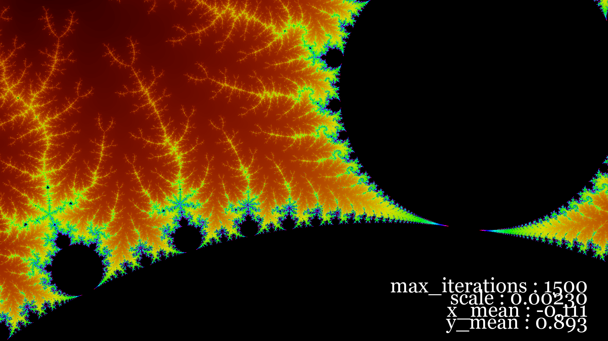

# Fractales

Diverses pages html simples qui génèrent une fractale en utilisant simplement son navigateur web grâce à la technologie html5 canvas.

Pour tester (privilégier Chrome) : 

https://julienperrin.github.io/Fractales/public

## Example d'images de la fractale Mandelbrot 




## How to run server locally

```bash
git clone git@github.com:JulienPerrin/Fractales.git
cd Fractales
#i nstall node with nvm if not installed
# https://github.com/nvm-sh/nvm
npm install
npm run start
```
