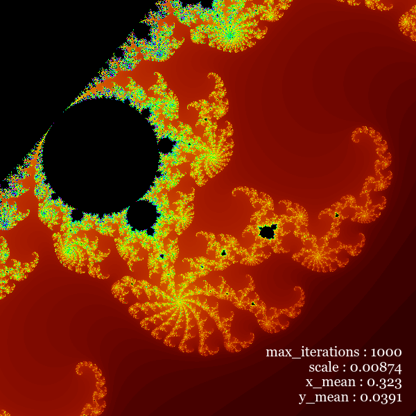

# Fractales

Pages HTML simples qui génèrent des fractales directement dans le navigateur grâce au canvas HTML5 (Mandelbrot CPU/GPU, triangle de Sierpinski).

Démo en ligne : <https://julienperrin.github.io/Fractales/>

## Exemples (Mandelbrot)




## Développement local

```bash
git clone git@github.com:JulienPerrin/Fractales.git
cd Fractales
npm install
npm run dev
```

Le serveur Vite démarre sur `http://localhost:5175`.

## Scripts

Les sources TypeScript sont dans `src/` et les tests dans `test/`. Vite génère le build statique dans `dist/` (déployé sur GitHub Pages via `.github/workflows/deploy.yml`) :

* `npm run dev` — serveur de développement Vite avec HMR (port `5175`)
* `npm run build` — build de production dans `dist/`
* `npm run preview` — prévisualisation locale du build `dist/` (port `5175`)
* `npm run typecheck` — vérification TypeScript (`tsc --noEmit`)
* `npm test` — exécution des tests unitaires Vitest
* `npm run test:coverage` — tests Vitest avec rapport de couverture
