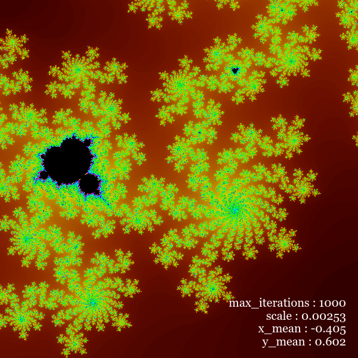

# Fractales

Diverses pages html simples qui génèrent une fractale en utilisant simplement son navigateur web grâce à la technologie html5 canvas.

Pour tester (privilégier Chrome et désactiver l'accélération graphique pour un résultat optimum) :

<https://julienperrin.github.io/Fractales/public>

## Example d'images de la fractale Mandelbrot





## How to run server locally

```bash
git clone git@github.com:JulienPerrin/Fractales.git
cd Fractales
# install node with nvm if not installed
# https://github.com/nvm-sh/nvm
npm install
npm run build
npm run start
```

## TypeScript & Tests

Source files live in `src/` and compile directly into `public/js/` (kept committed for GitHub Pages):

- `npm run build` — compile TypeScript (`src/*.ts`) into `public/js/*.js`
- `npm run watch` — watch `src/*.ts` and recompile on change
- `npm run typecheck` — run `tsc --noEmit`
- `npm test` — run Vitest unit tests
- `npm run test:coverage` — run Vitest with coverage report
- `npm run dev` — run the app in local, must do `npm install -g nodemon` before
